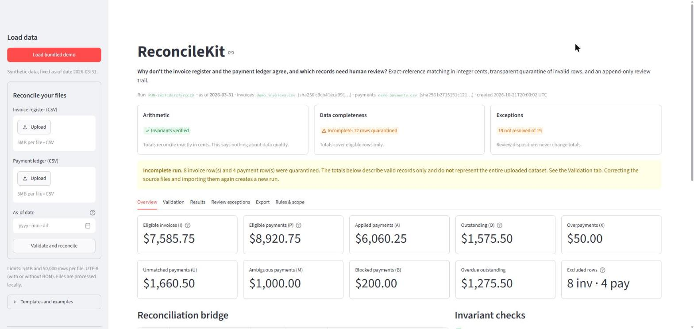
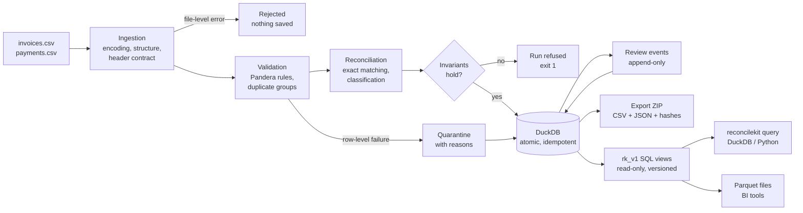
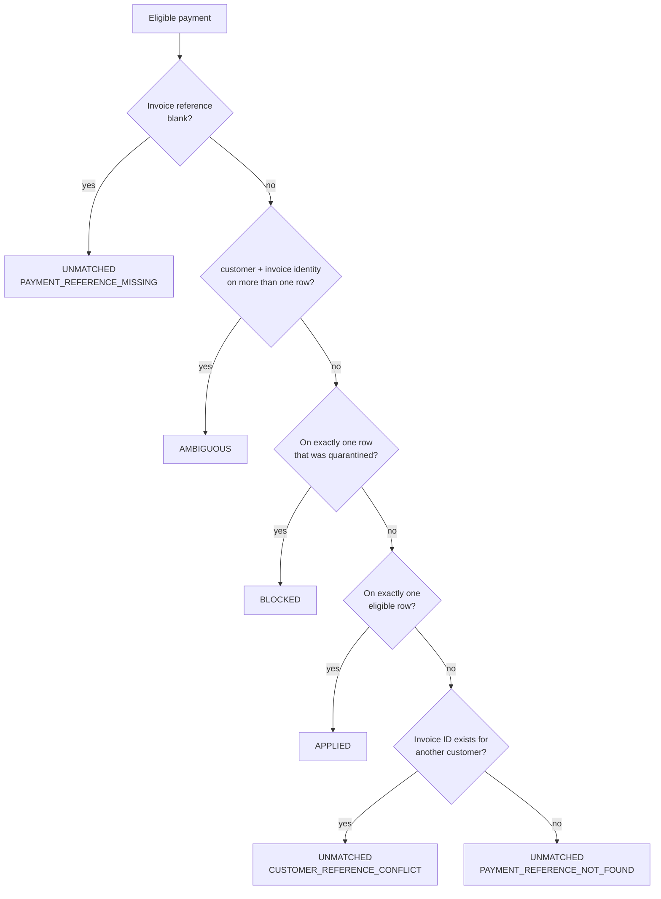
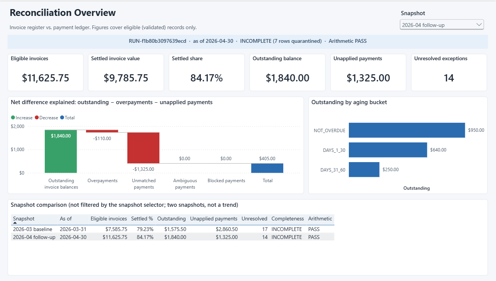
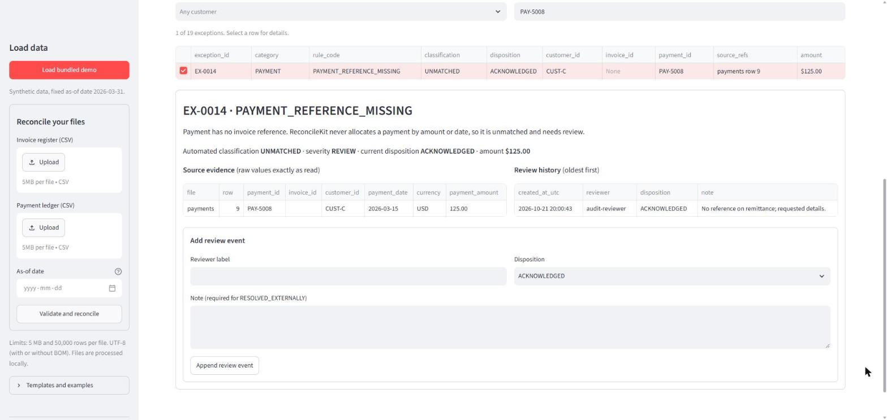

# ReconcileKit

[](https://github.com/RichieGarafola/ReconcileKit/actions/workflows/ci.yml)
[](https://github.com/RichieGarafola/ReconcileKit/actions/workflows/audit.yml)
[](LICENSE)

**Why don't the invoice register and the payment ledger agree, and which records need a
human to look at them?**

ReconcileKit reconciles an invoice register against a payment ledger with explicit,
explainable rules. It works in exact integer cents, quarantines invalid or duplicated rows
instead of guessing, ties the totals out through a bridge whose arithmetic is checked on
every run, and keeps an append-only review trail that never alters the automated findings.
It runs locally as a CLI and a Streamlit app that share one engine and one DuckDB database,
and publishes its results through versioned, read-only SQL views (`rk_v1`) and Parquet
files for reporting tools.



<sub>Screenshot from the running app with the bundled synthetic demo.</sub>

## The problem

Month-end close and collections work often comes down to two exports that should agree and
don't. The questions are always the same: which invoices are still open, which payments
can't be tied to an invoice, whether a gap is real or caused by bad data, and who has looked
at each issue.

Spreadsheet lookups answer quickly, but they hide the failure modes that matter in finance:

| Spreadsheet habit | What goes wrong | ReconcileKit instead |
|---|---|---|
| `VLOOKUP` takes the first match | A duplicated invoice silently absorbs a payment | Every row of a duplicated identity is quarantined; payments to it are **AMBIGUOUS** |
| Floats and rounding | `99.999` becomes `100.00`; one-cent drift creates false exceptions | Strict text-to-integer-cents parsing; anything unparseable is rejected, never rounded |
| Bad rows are dropped or coerced | Totals look complete but aren't | Bad rows are listed with reasons and the run is labelled **incomplete** |
| Fuzzy or amount-based matching | Confident-looking wrong allocations | Exact `customer_id + invoice_id` only; near misses are explained, not matched |
| Edits overwrite the evidence | No record of what the data said | Findings are immutable; reviews are separate, append-only events |
| Reports rebuilt from exported files | Each report re-derives totals its own way, and they disagree | One read-only SQL contract with exact amounts and the bridge checks included |

Reconciliation results feed close reporting, collections, and audit requests. That only
works if every consumer reads the same figures, can trace each one to source rows, and can
see which records were excluded and why.

## How it works



Every payment lands in exactly one category, decided by the first rule that applies:



Invoices are then classified **UNPAID**, **PARTIALLY_PAID**, **PAID**, or **OVERPAID** from
the payments applied to them, and overdue status is computed against an explicit as-of date
(never the machine clock).

## The reconciliation bridge

Each run explains the net difference between invoices and payments line by line, and the
engine refuses to save a run unless these identities hold exactly, in cents:

| Symbol | Meaning |
|---|---|
| I / P | eligible invoice total / eligible payment total |
| A | payments applied to invoices |
| O / X | outstanding balances / overpayments |
| U / M / B | unmatched / ambiguous / blocked payments |

**I − A = O − X**, **P = A + U + M + B**, and therefore **I − P = O − X − U − M − B**.

Output of `reconcilekit demo` (unedited; reproduced by
[`scripts/generate_sample_outputs.py`](scripts/generate_sample_outputs.py)):

```text
Run RUN-2e17cda32757cc29 (new)
As-of date: 2026-03-31
Data completeness: INCOMPLETE - 8 invoice and 4 payment rows quarantined. Totals cover eligible records only.
    Eligible invoices                     $7,585.75
  - Eligible payments                     $8,920.75
  = Net difference                       -$1,335.00
  + Outstanding invoice balances          $1,575.50
  - Overpayments                             $50.00
  - Unmatched payments                    $1,660.50
  - Ambiguous payments                    $1,000.00
  - Blocked payments                        $200.00
  = Explained difference                 -$1,335.00
  Invariant I - A = O - X: PASS
  Invariant P = A + U + M + B: PASS
  Invariant I - P = O - X - U - M - B: PASS
Exceptions requiring review: 19 {'OPEN': 19}
Export written: exports/reconcilekit_RUN-2e17cda32757cc29.zip
```

The demo is *incomplete* on purpose: it plants duplicates, a blank amount, `99.999`, a EUR
row, and a future-dated invoice to show quarantine. Outstanding balances and overpayments
offset in the net difference, so a small net difference never means the books are settled.
That is why the bridge is shown in full.

## SQL reporting (`rk_v1`)

Every database ReconcileKit writes contains a `rk_v1` schema of read-only views, so an
analyst or BI tool can query results directly instead of stitching export CSVs together:

| View | One row per |
|---|---|
| `rk_v1.run_summary` | Run: metadata, bridge totals, settled share, invariant checks, unresolved exceptions |
| `rk_v1.open_invoices` | Invoice with an outstanding balance, with aging bucket and review state |
| `rk_v1.payment_exceptions` | Payment that could not be applied, with the reason and review state |
| `rk_v1.exception_status` | Exception in the review queue, with its latest disposition and timestamps |

Amounts come in two exact forms: `*_cents` (`BIGINT`, as stored) and `*_usd`
(`DECIMAL(38,2)`). No view column is floating point. Every view carries `run_id`, so runs
never mix, and the contract is versioned: a breaking change would ship as `rk_v2` beside it.

```bash
reconcilekit query --db data/reconcilekit.duckdb --format markdown \
    --file examples/sql/03_customers_by_outstanding.sql --param run_id=RUN-2e17cda32757cc29
reconcilekit parquet --db data/reconcilekit.duckdb --run-id RUN-2e17cda32757cc29 --out-dir parquet
```

`query` runs on a read-only connection with DuckDB's external file access disabled. Any
DuckDB client works as well (`duckdb.connect(path, read_only=True)` or
`ATTACH 'reconcilekit.duckdb' AS rk`).

Results for the bundled demo (generated by the commands above; CI fails if they drift):

**What share of invoice value is settled, and does the bridge tie out?**
([`01_reconciliation_overview.sql`](examples/sql/01_reconciliation_overview.sql))

| run_id | as_of_date | data_completeness | eligible_invoice_usd | settled_invoice_usd | settled_invoice_pct | outstanding_usd | overpayment_usd | net_difference_usd | explained_difference_usd | arithmetic_status |
|---|---|---|---|---|---|---|---|---|---|---|
| RUN-2e17cda32757cc29 | 2026-03-31 | INCOMPLETE | 7585.75 | 6010.25 | 79.23 | 1575.50 | 50.00 | -1335.00 | -1335.00 | PASS |

Settled share = (eligible invoices − outstanding) / eligible invoices. Quarantined rows are
excluded from the denominator, which is why `data_completeness` sits next to it.

**Which customers hold the largest outstanding balances?**
([`03_customers_by_outstanding.sql`](examples/sql/03_customers_by_outstanding.sql))

| customer_id | open_invoices | outstanding_usd | share_of_outstanding_pct |
|---|---|---|---|
| CUST-C | 1 | 975.50 | 61.9 |
| CUST-B | 1 | 300.00 | 19.0 |
| CUST-D | 1 | 300.00 | 19.0 |

**Which payment exceptions need investigation, largest first?**
([`04_payment_exceptions.sql`](examples/sql/04_payment_exceptions.sql))

| payment_id | customer_id | invoice_reference_as_received | payment_amount_usd | status | rule_code | current_disposition |
|---|---|---|---|---|---|---|
| PAY-5012 | CUST-E | INV-1009 | 1000.00 | AMBIGUOUS | AMBIGUOUS_INVOICE_REFERENCE | OPEN |
| PAY-5009 | CUST-C | inv-1005 | 975.50 | UNMATCHED | PAYMENT_REFERENCE_NOT_FOUND | OPEN |
| PAY-5010 | CUST-A | INV-9999 | 310.00 | UNMATCHED | PAYMENT_REFERENCE_NOT_FOUND | OPEN |
| PAY-5011 | CUST-B | INV-1001 | 250.00 | UNMATCHED | CUSTOMER_REFERENCE_CONFLICT | OPEN |
| PAY-5013 | CUST-F | INV-1011 | 200.00 | BLOCKED | REFERENCED_INVOICE_INVALID | OPEN |
| PAY-5008 | CUST-C |  | 125.00 | UNMATCHED | PAYMENT_REFERENCE_MISSING | OPEN |

More questions (aging, unresolved exceptions by category, listing runs) are in
[`examples/sql/`](examples/sql/). The full column contract, financial definitions, and
run-selection guidance are in [SQL reporting](docs/sql-reporting.md).

### Power BI demonstration

[`powerbi/`](powerbi/) follows two synthetic month-end snapshots through to a working Power BI
report (`RK.pbip`): a deterministic pipeline (snapshot CSVs → reconciliation → scripted reviews
→ `rk_v1` → Parquet), a semantic model with run-scoped composite keys, Fixed decimal money and
guarded DAX measures, and three report pages (overview, exceptions, data quality). The project
is generated from tested sources; its DAX was executed in Power BI Desktop and matched the
hand-calculated results (76/76 checks). See [`powerbi/README.md`](powerbi/README.md).



## Features

- **Exact money.** Amounts are validated as text and converted to integer cents with
  `Decimal`; sums, comparisons, and storage (DuckDB `BIGINT`) never use floats.
- **Two-level validation.** File-level problems (encoding, headers, malformed CSV) stop the
  run. Row-level problems quarantine only the affected rows, each with a stable rule code.
- **Explainable outcomes.** Every result carries a rule code, a plain-language explanation,
  source row numbers, and raw plus normalized identifiers.
- **Review workflow.** Reviewers append dispositions (OPEN, ACKNOWLEDGED, INVESTIGATING,
  RESOLVED_EXTERNALLY) with notes; retries are idempotent and conflicting retries are rejected.
- **Reproducible runs.** The run ID is a fingerprint of the input bytes, rules, versions, and
  as-of date, so re-importing identical files reuses the stored run.
- **Portable evidence.** The export ZIP contains results, exceptions, validation errors,
  review history, and a manifest with SHA-256 hashes of every packaged file.
- **Spreadsheet-safe exports.** Cells that a spreadsheet could execute as a formula are
  escaped, in the export package, the app's table downloads, and `query` CSV output.
- **SQL reporting contract.** Versioned read-only views with exact money types, a
  read-only query command, and per-run Parquet export.

## Technical implementation

| Concern | Implementation |
|---|---|
| Parsing and validation | Python 3.11+, strict CSV ingestion, [Pandera](https://pandera.readthedocs.io/) schemas named after rule codes, `Decimal` → integer cents |
| Engine | Pure Python (`reconcile_files`), no UI or database dependency; frozen dataclasses; invariants checked before anything is stored |
| Storage | Embedded DuckDB: one atomic transaction per run, parameterized SQL, append-only review events |
| Reporting | SQL views in [`src/reconcilekit/sql/rk_v1.sql`](src/reconcilekit/sql/rk_v1.sql), installed idempotently on every connection; Parquet via DuckDB's native writer (no extra dependency) |
| Interfaces | Streamlit app and an `argparse` CLI over the same engine and database |
| Quality | pytest + Hypothesis, Ruff, GitHub Actions on Linux and Windows, weekly `pip-audit`, committed sample outputs checked for drift |

## Quick start

Requires Python 3.11–3.13. These steps were run on Windows 11 with CPython 3.11.9.

```bash
git clone https://github.com/RichieGarafola/ReconcileKit.git && cd ReconcileKit
python -m venv .venv
# Windows: .venv\Scripts\activate    macOS/Linux: source .venv/bin/activate
python -m pip install -c requirements-lock.txt -e ".[dev]"

reconcilekit demo --export-dir exports   # CLI: prints the bridge, writes the ZIP (exit code 2, see below)
reconcilekit query --format markdown --file examples/sql/01_reconciliation_overview.sql \
    --param run_id=RUN-2e17cda32757cc29  # SQL: query the rk_v1 views in data/reconcilekit.duckdb
streamlit run app.py                     # UI: click "Load bundled demo"
```

No credentials, network services, or API keys are needed.

**Your own files:**

```bash
reconcilekit reconcile --invoices invoices.csv --payments payments.csv \
    --as-of 2026-03-31 --db data/reconcilekit.duckdb --export-dir exports [--json]

reconcilekit export --run-id RUN-xxxxxxxxxxxxxxxx --db data/reconcilekit.duckdb --export-dir exports
```

Required columns (any order, extra columns ignored):

- **Invoices:** `invoice_id, customer_id, invoice_date, due_date, currency, invoice_amount`
- **Payments:** `payment_id, invoice_id, customer_id, payment_date, currency, payment_amount`

Dates are `YYYY-MM-DD`, currency must be `USD`, and amounts are positive plain decimals with
at most two places. The full input contract is in the [reference](docs/reference.md#input-contract).

### Exit codes

| Code | Meaning |
|---|---|
| `0` | Run completed, every row was eligible, invariants passed. |
| `2` | Invalid input: a file-level error (nothing saved), **or** the run completed but some rows were quarantined (*incomplete*; still saved and exported). Usage errors, and `query`/`parquet` requests that cannot be served (missing database or run, invalid SQL, attempted write), also exit 2. |
| `1` | Internal failure, including a financial-invariant violation (nothing saved). Set `RECONCILEKIT_DEBUG=1` to print the traceback. |

Business findings such as unpaid invoices do **not** change the exit code, because finding
them is the tool working correctly. Scripts should read the `--json` output
(`status`, `exception_count`, `invoice_status_counts`, `payment_status_counts`,
`net_difference_cents`, …); see [`docs/sample-output/cli-demo.json`](docs/sample-output/cli-demo.json).

### Installation notes

- **Reproducible install:** `requirements-lock.txt` pins every package version used for
  testing and is applied as pip *constraints*. Lower bounds in `pyproject.toml` are the
  tested versions; newer versions within the upper bounds are allowed but untested.
- **Wheel vs. checkout:** an installed wheel provides the CLI and the bundled demo. The
  Streamlit UI (`app.py`) and the tests require a source checkout.
- **Windows:** keep the checkout and virtual environment in a short path. Streamlit ships
  deeply nested files, and a long path can fail with `WinError 206` unless long-path support
  is enabled.

## Sample outputs

[`docs/sample-output/`](docs/sample-output/) holds the demo's CLI output and the result files
from its export package: [`invoice_results.csv`](docs/sample-output/invoice_results.csv),
[`payment_results.csv`](docs/sample-output/payment_results.csv),
[`exceptions.csv`](docs/sample-output/exceptions.csv), and
[`validation_errors.csv`](docs/sample-output/validation_errors.csv), plus the output of each
example query in [`sql/`](docs/sample-output/sql/). Files carrying export or run-creation
timestamps are left out so the samples are byte-reproducible. A test fails if they drift from
what the code produces; regenerate them with `python scripts/generate_sample_outputs.py`.

Every expected value for the demo was also calculated by hand from the CSVs, independently
of the engine: see [`docs/demo-expected-results.md`](docs/demo-expected-results.md).



## Engineering tradeoffs

| Decision | Benefit | Cost accepted |
|---|---|---|
| Integer cents, strict parsing, no rounding | No float drift; output always agrees with the source | Inputs with `$`, thousands separators, or 3+ decimals must be cleaned upstream |
| Exact references only | No wrong-but-confident allocations | More payments land in UNMATCHED for human review |
| Quarantine whole duplicate groups | No arbitrary "first row wins" | One bad duplicate holds back its valid twin until the source is fixed |
| Immutable findings + append-only reviews | Evidence of what the data said is preserved | Fixing data means re-importing, which creates a new run |
| Embedded DuckDB | Real SQL and transactions; no server or credentials | One writer process at a time; not a multi-user service |
| Byte-level run identity | Simple, verifiable reproducibility | Reordering rows or changing line endings creates a new run |
| Reporting as versioned views, not copied tables | One source of truth; nothing to refresh or drift; reviews show up immediately | Each query recomputes from storage (fine at the 50,000-row upload limit) |
| Cents and `DECIMAL(38,2)` columns side by side | Exact for arithmetic and readable for reports; BI tools get a native decimal | Wider views; consumers must not mix the two forms |
| No "current run" view | Which run is authoritative stays an explicit business choice | Every query filters on `run_id` |

Rationale for each is in [design decisions](docs/design-decisions.md).

## Testing and quality checks

```bash
pytest                    # full suite
ruff check . && ruff format --check .
python scripts/generate_sample_outputs.py --check
```

- **Example-based tests** cover every matching branch, duplicate groups, as-of and overdue
  boundaries, idempotent re-import, append-only reviews, export precision, formula escaping,
  a CLI end-to-end run from files to database to ZIP, and the Streamlit UI driven headlessly
  with `AppTest`.
- **Property-based tests** ([`tests/test_properties.py`](tests/test_properties.py), Hypothesis)
  generate random ledgers with deliberate collisions (duplicate and invalid invoice rows,
  padded, blank, unknown, and cross-customer references) and compare the engine against an
  independent model of the matching contract. They check cents round-trips and rejection of
  rounding and presentation formats, agreement of every total and status (including
  AMBIGUOUS and BLOCKED) with totals recomputed from the input via `Decimal`,
  exact-identity-only matching, row-order independence, determinism, and quarantine (never
  coercion) of invalid amounts. CI runs 200 examples per test; local runs default to 50
  (`HYPOTHESIS_PROFILE=ci pytest` for the full count).
- **Reporting tests** ([`tests/test_reporting_views.py`](tests/test_reporting_views.py))
  check the view contract (names, order, exact types, and that the docs match the live
  schema), demo figures against the hand calculation, run isolation with overlapping
  exception IDs, review state ordering, empty and zero-invoice runs, unusual identifiers
  through views and Parquet, read-only and sandboxed querying, and a property-based
  comparison of the views with the same independent model.
- **CI** ([`ci.yml`](.github/workflows/ci.yml)) runs lint, format, tests, a demo smoke run,
  and a wheel install smoke test (including a `query` against the installed package) on
  Ubuntu (Python 3.11, 3.12, 3.13) and Windows (3.11).
- **Dependency audit** ([`audit.yml`](.github/workflows/audit.yml)) runs `pip-audit` against
  the lockfile on every change and weekly.

## Scope and limitations

Out of scope by design: currencies other than USD, refunds and credit notes, one
payment split across several invoices, fuzzy or amount/date matching, document or PDF
inputs, AI-generated decisions, authentication or multi-user use, cloud deployment, and
scheduled ingestion.

Known limitations:

- Single user, single writer: running the app and CLI at the same moment against the same
  database file can fail with a lock error. Use separate files (`--db`, `RECONCILEKIT_DB`).
- The database is not tamper-proof; anyone with file access can modify it. For tamper
  evidence, keep the exported package and its `manifest.json` hashes.
- Spreadsheet programs may drop leading zeros when opening exported CSVs unless identifier
  columns are imported as text. The files themselves preserve them.
- The reporting views add no financial logic: they present what the engine stored, so the
  same scope limits apply. The Streamlit app does not yet expose the SQL views.
- `query` disables file access for its own connection, but it is a convenience for a local
  single-user tool, not a security boundary for untrusted users.
- There is no hosted demo; run it locally with the steps above.

## Documentation

- [SQL reporting](docs/sql-reporting.md): `rk_v1` views, column contract, financial
  definitions, connecting, run selection, Parquet
- [Power BI demonstration](powerbi/README.md): synthetic snapshots, data pipeline, semantic
  model, DAX catalog, verification status
- [Reference](docs/reference.md): Streamlit UI, input contract, matching and duplicate rules,
  invariants, review semantics, persistence, export package, module map
- [Design decisions](docs/design-decisions.md)
- [Demo expected results](docs/demo-expected-results.md) (hand-calculated oracle)
- [Synthetic data notice](examples/README.md) · [Third-party notices](docs/third-party-notices.md)

## Data notice

All bundled data is synthetic: identifiers, customers, dates, and amounts were invented to
exercise specific rules. Do not commit real invoice or payment data. `data/`, `exports/`,
`*.duckdb`, and generated ZIP files are git-ignored.

## License

Licensed under the [Apache License, Version 2.0](LICENSE). Copyright 2026 Richie Garafola.
Third-party dependencies keep their own licenses (see
[third-party notices](docs/third-party-notices.md)).
