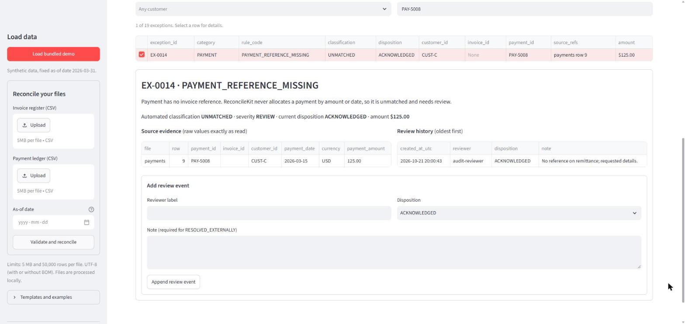

# ReconcileKit reference

Detailed behavior of the engine, user interface, storage, and export package. The
[README](../README.md) gives the overview; this page is the contract.

## Streamlit UI

```bash
streamlit run app.py
```

- The database defaults to `data/reconcilekit.duckdb`. Override it with the
  `RECONCILEKIT_DB` environment variable.
- Upload limit: 5 MB and 50,000 data rows per file. It is enforced by the engine and by
  `.streamlit/config.toml`.
- Tabs: **Overview** (totals, bridge, invariants), **Validation** (row counts, quarantined
  rows, downloadable report), **Results** (per-invoice and per-payment outcomes), **Review
  exceptions** (filters, evidence, history, add event), **Export**, **Rules & scope**.
- Three separate indicators: *arithmetic* (invariants hold), *data completeness* (were rows
  quarantined?), and *exceptions* (how many are not yet resolved). The app never shows a
  single "balanced" badge that would merge these.
- If a submission is rejected at file level, the error box says so, and it also names the
  previously selected run that is still displayed beneath it.
- The theme follows the viewer's light/dark system preference. Both were checked for
  readability.
- Ingesting files and appending reviews happen only on explicit button or form
  submissions. Both are idempotent, so Streamlit reruns do not duplicate data.
- **On-screen grids and their CSV download.** Streamlit 1.66 offers no supported way to turn
  off the download button on `st.dataframe`. Every interactive grid that can hold uploaded
  identifiers, source values, reviewer labels, or notes therefore receives a *presentation
  copy* passed through the same `escape_formula` rule as the export package
  (`reconcilekit.exports.escape_frame`). A value such as `=HYPERLINK(...)` is shown, and
  downloaded, as `'=HYPERLINK(...)`. Stored data, matching, and the export package are
  unaffected, and the export escapes from stored values, so nothing is escaped twice.
  `st.table` (which has no download, but renders cells as Markdown) is used only for the
  app-generated bridge and status-count tables. Explanations and file-error messages that
  quote uploaded text are rendered as plain text, never as Markdown. A test checks that
  every `st.dataframe` call in `app.py` passes through `escape_frame`.
- The leading `'` blocks formula evaluation in common spreadsheet programs that honor it.
  It cannot guarantee safe behavior in every spreadsheet product or import mode.




## Input contract

The column names below are required, in any order. Header names are matched exactly
(case-sensitive) after trimming surrounding whitespace. **Extra columns are ignored**: they
are listed as "ignored extra columns" in the validation report and manifest, and their
values are not stored.

**Invoices:** `invoice_id, customer_id, invoice_date, due_date, currency, invoice_amount`
**Payments:** `payment_id, invoice_id, customer_id, payment_date, currency, payment_amount`

| Rule | Behavior |
|---|---|
| Encoding | UTF-8, with or without BOM. Other encodings (including UTF-16) are rejected with a re-save hint. |
| Structure | Missing columns, duplicate headers, wrong field counts, bad quoting, or NUL bytes block the run (file-level error). |
| Identifiers | Read as text. Required, except payment `invoice_id`, which may be blank. Leading zeros, case, punctuation, and internal whitespace are preserved. |
| Dates | Strict `YYYY-MM-DD`. `due_date ≥ invoice_date`. Invoice and payment dates after the as-of date are quarantined. Future due dates are allowed. |
| Currency | Trimmed and upper-cased, then must equal `USD`. |
| Amounts | Positive plain decimals with at most 2 places (`1234.5`, `1234.50`). Blank → invalid (never zero). Zero, negative, exponent (`1.2e3`), `NaN`/`inf`, `$`, thousands separators, and more than 2 decimals (`99.999`, never rounded) are invalid. |

Row numbers in all reports count the header as row 1, matching spreadsheet row numbers. A
quoted field that contains a line break counts as part of one row.

## Matching and duplicate rules

Only surrounding whitespace is trimmed from identifiers (and currency is upper-cased). A
match that relied on trimming says so in its explanation.

**Identity:** an invoice is `customer_id + invoice_id`; a payment is `payment_id` (unique
across the ledger).

**Duplicates:** every row sharing an identity is quarantined, whether the copies are
identical or conflicting (the explanation says which fields differ). No row is ever chosen
arbitrarily. Duplicates are detected across all readable rows **before** rows with other
problems are removed, so an invalid sibling cannot make a conflicting identity look unique.

**Payment decision order** (the first rule that applies wins, so each payment's money
lands in exactly one category):

| # | Condition | Status | Rule code |
|---|---|---|---|
| 1 | Blank invoice reference | UNMATCHED | `PAYMENT_REFERENCE_MISSING` |
| 2 | Identity appears on more than one invoice row | AMBIGUOUS | `AMBIGUOUS_INVOICE_REFERENCE` |
| 3 | Identity appears on exactly one row, which is quarantined | BLOCKED | `REFERENCED_INVOICE_INVALID` |
| 4 | Identity appears on exactly one eligible row | APPLIED | `EXACT_REFERENCE_MATCH` |
| 5 | The invoice ID exists only for other customers | UNMATCHED | `CUSTOMER_REFERENCE_CONFLICT` |
| 6 | Otherwise | UNMATCHED | `PAYMENT_REFERENCE_NOT_FOUND` |

**AMBIGUOUS vs BLOCKED:** *ambiguous* means the reference cannot identify a single invoice
(the identity is duplicated). *Blocked* means it identifies exactly one invoice, but that
invoice failed validation. Neither is applied.

Amounts and dates are never used to infer a match, and tolerance is zero cents. A payment
dated before its invoice still applies, with an informational `PAYMENT_BEFORE_INVOICE_DATE`
note. An invoice is **overdue** only when `due_date < as-of date` and its outstanding amount
is positive. A due date equal to the as-of date is not overdue.

## Financial invariants

Over **eligible** records only:

| Symbol | Meaning |
|---|---|
| I | eligible invoice total |
| A | payments applied to invoices |
| O | outstanding = Σ max(invoice − applied, 0) |
| X | overpayment = Σ max(applied − invoice, 0) |
| P | eligible payment total |
| U / M / B | unmatched / ambiguous / blocked payments |

The engine verifies **I − A = O − X**, **P = A + U + M + B**, and therefore
**I − P = O − X − U − M − B**. It also checks each invoice, checks that A agrees between the
invoice and payment views, and checks that no payment is applied twice. If any check fails,
the run is refused and nothing is saved.

The bridge on the Overview tab and in `summary.json` shows the net difference I − P
explained line by line. Outstanding balances and overpayments **offset** in the net
difference. A small net difference does not mean invoices are settled.

## Validation exclusions

Quarantined rows (row-level validation failures and every member of a duplicate group) are
outside every monetary total. They are shown in the Validation tab and
`validation_errors.csv` with every reason, and they make the run **incomplete**: the totals
then describe valid records only, not the whole upload. Amounts that cannot be parsed are
never summed into any figure.

## Review semantics

- Each review event stores run ID, exception ID, reviewer label, disposition, note, UTC
  timestamp, and a unique event ID. A note is required for `RESOLVED_EXTERNALLY`.
- The current disposition is the latest event, and history is shown oldest first.
- **Retries:** each submission carries an event ID. Resending the same event ID with the
  same logical payload (run, exception, reviewer, disposition, note, compared after
  trimming) is a no-op. Resending it with a *different* payload is rejected as a conflict
  and nothing is stored. The timestamp is not part of the comparison. A new event ID with
  identical content is a legitimate later event and is appended.
- Reviews never reallocate payments, change source data or findings, remove anything from
  totals, or make an incomplete run complete. To correct the data, fix the source files and
  import them again, which creates a **new run**.
- Reviewer labels are **self-reported free text**. ReconcileKit is a local single-user tool
  with no authentication.

**What "immutable" and "append-only" mean here:** the application has no code path that
updates or deletes findings, source rows, or review events. Its only writes are a
whole-run insert and a review-event insert, both in transactions with primary-key
constraints. The DuckDB file itself is **not** tamper-proof: anyone with file access can
modify it with other tools, and nothing in v1 detects that. If you need tamper evidence,
keep the exported package and its `manifest.json` hashes.

## Persistence and reproducibility

Each run is stored atomically in DuckDB with its UTC creation time, as-of date, source
SHA-256 hashes, rule configuration and versions, counts, totals, results, exceptions, raw
source values, and review events. All SQL is parameterized.

The run ID comes from a fingerprint of *invoice file hash + payment file hash + normalized
rule configuration + as-of date + engine/rule version*. Re-importing **byte-identical** files
with the same settings reuses the existing run, with no duplicate facts or review events.
Changing a byte, the as-of date, or the rules creates a distinct run. Identity is based on
bytes, not rows: reordering rows or changing line endings produces a new run.

## Export package

`reconcilekit_<run_id>.zip` contains `summary.json`, `invoice_results.csv`,
`payment_results.csv`, `exceptions.csv` (including the disposition at export time),
`validation_errors.csv`, `review_history.csv`, `manifest.json` (run, source hashes, as-of
date, versions, export timestamp, SHA-256 of every packaged file) and `README.txt`.

- Money is written as exact two-decimal strings derived from cents, and the exporter
  refuses to format a money column that is not integer-typed.
- **Formula-injection protection:** a CSV text cell is prefixed with `'` if it starts with a
  control or invisible format character (tab, CR, LF, NUL, zero-width space, …), or if its
  first non-whitespace character is `=`, `+`, `-`, `@` or a full-width form of one of these.
  This also affects legitimate values such as a raw `-5.00` in `validation_errors.csv`,
  which is exported as `'-5.00`. Stored values are not changed. JSON files are not escaped.
- **Leading zeros:** identifiers are written as text, so the CSV bytes keep `000123`. CSV has
  no type information, though, and spreadsheet programs may convert such columns to numbers
  when opening the file. Import identifier columns as *Text* to keep the zeros.
- Exceptions for quarantined rows carry no `amount`, because a quarantined value (e.g. a EUR
  amount) is never presented as USD money. The raw value is in `validation_errors.csv`.
- Source files are not included. The ZIP filename is generated from the run ID, never from
  uploaded filenames, and uploaded filenames are reduced to safe display labels.

## Module map

| Module | Responsibility |
|---|---|
| `models.py` | Enums (statuses, rule codes, dispositions) and frozen result dataclasses |
| `money.py` | Strict decimal parsing to integer cents and formatting |
| `normalization.py` | Identifier trimming, currency normalization, strict ISO dates |
| `ingestion.py` | Encoding, CSV structure, header contract, raw-string frame, safe labels |
| `validation.py` | Pandera schema (checks named after rule codes), cross-field rules, duplicate groups |
| `reconciliation.py` | Decision order, invoice/payment classification, exceptions, invariants, fingerprint |
| `repository.py` | DuckDB schema, atomic idempotent run save, validated append-only review events |
| `reporting.py` | SQL queries (latest disposition via `arg_max`), bridge, invariant re-checks |
| `exports.py` | ZIP package, money formatting, formula escaping, manifest |
| `reporting_views.py`, `sql/rk_v1.sql` | Versioned read-only SQL views (`rk_v1`), read-only query, Parquet export; see [SQL reporting](sql-reporting.md) |
| `cli.py`, `demo.py`, `demo_data/` | Command-line entry point (`reconcile`, `demo`, `export`, `query`, `parquet`); bundled demo CSVs loaded via `importlib.resources` |
| `app.py` | Streamlit presentation only |

The engine (`reconcile_files`) has no Streamlit or database dependency.

