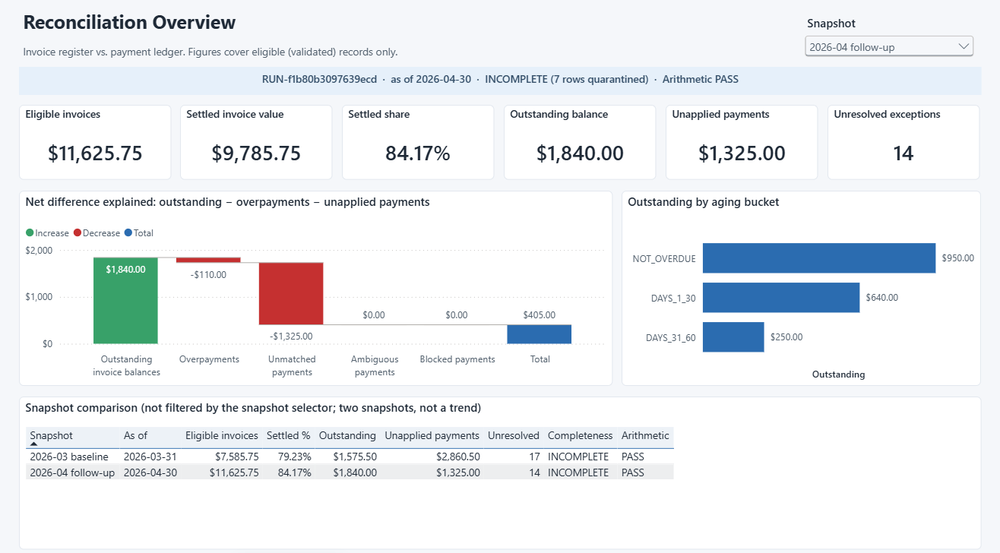
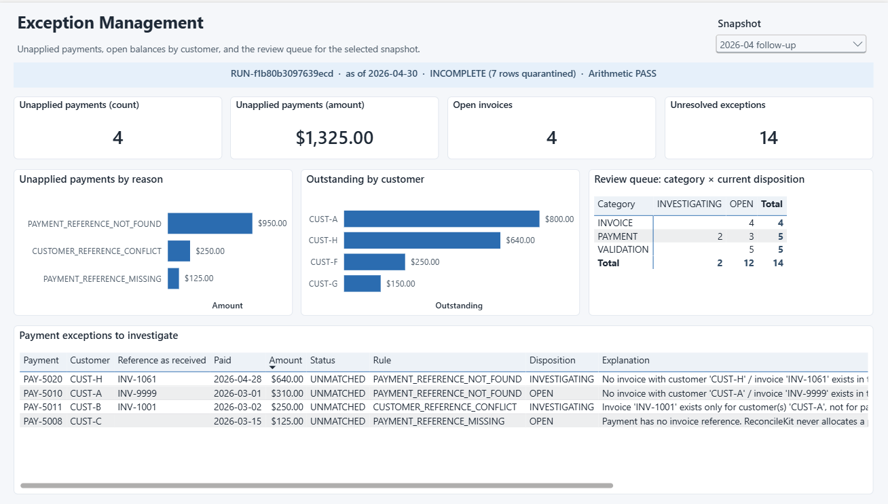
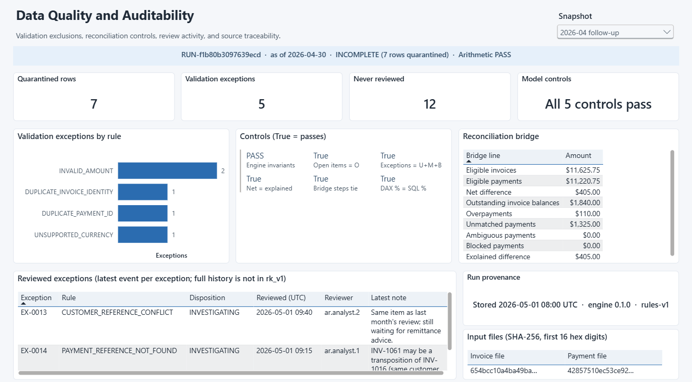

# ReconcileKit: Power BI demonstration

A month-end reconciliation, followed through to a working Power BI report. Two synthetic
snapshots of an invoice register and a payment ledger are validated and reconciled by
ReconcileKit, stored in DuckDB, published through the read-only `rk_v1` SQL views, exported to
Parquet, and modelled in a Power BI project (`RK.pbip`) with exact money types, a guarded DAX
measure catalog, and three report pages.



**Status:** built and validated in Power BI Desktop 2.159 (October 2026). The project loads,
refreshes from the committed Parquet files, and passes **76 of 76** checks run against the
Desktop engine. Those checks cover row counts, Fixed decimal types, and every KPI, control,
and customer balance compared with the expected results; see
[`validation/desktop-validation.md`](validation/desktop-validation.md). The screenshots were
captured from that running report.

## The reporting problem

Finance teams report reconciliation results to people who never see the reconciliation:
controllers want the settled share and the open balance, collections wants the customers and
items to chase, auditors want to know what was excluded and why. Spreadsheet-built reports
recompute those figures independently, mix months together, and drop the rows that failed
validation without saying so.

This report keeps one definition of every number. The engine's totals are the source of truth;
the report reads them rather than re-deriving them, shows data completeness next to every
percentage, never adds two reconciliation runs together, and includes controls that prove the
detail rows add up to the engine totals.

## Architecture

```mermaid
flowchart LR
    A[Snapshot CSVs<br/>2026-03-31, 2026-04-30] --> B[ReconcileKit<br/>validation + exact-cent<br/>reconciliation]
    E[Scripted review events<br/>fixed timestamps] --> C
    B --> C[(DuckDB<br/>runs, findings,<br/>review events)]
    C --> D[rk_v1 SQL views<br/>read-only, versioned]
    D --> F[Parquet per run<br/>reconcilekit parquet]
    F --> G[Model files<br/>keys, bridge, customers<br/>DuckDB SQL, tested]
    G --> H[RK.SemanticModel<br/>TMDL: Fixed decimal money,<br/>guarded measures]
    H --> I[RK.Report<br/>PBIR: 3 pages]
    H -. DAX via ADOMD.NET .-> V[validate_model.py<br/>76 checks]
```

| Step | Built by | Verified by |
|---|---|---|
| Snapshots → model Parquet files | `scripts/build_dataset.py` | `tests/test_powerbi_demo.py` (CI): hand-calculated totals, keys, exact money, isolation, controls |
| Semantic model + report (`RK.pbip`) | `scripts/build_pbip.py` generates TMDL and PBIR from the tested sources | `tests/test_powerbi_pbip.py` (CI): generator drift, every report field exists in the model, Fixed decimal types, slicer and interaction rules; Microsoft's JSON schemas (offline, during development) |
| Model in Power BI | Power BI Desktop opens `RK.pbip` and refreshes | `scripts/validate_model.py` runs `model/measures.dax` in the Desktop engine (76/76); CI checks that the report's input hashes still match |

## The report

Every page has a single-select **Snapshot** slicer, synced across pages and defaulting to the
latest snapshot, and a banner with the run ID, as-of date, data completeness, and arithmetic
status. Every aggregating measure returns BLANK unless exactly one snapshot is selected, so no
visual can add two months together.

**1. Reconciliation Overview** (above): eligible invoices, settled invoice value, settled
share, outstanding balance, unapplied payments, and unresolved exceptions. A waterfall shows how
outstanding balances, overpayments, and unapplied payments explain the net difference between
invoices and payments ($405.00 in April). Outstanding is broken down by aging bucket, and a
side-by-side table compares the two snapshots. That table deliberately ignores the slicer: two
points are compared, not presented as a trend.



**2. Exception Management**: unapplied payments by reason, outstanding by customer, the review
queue by category and current disposition, and the payment exceptions to investigate, with
the reference as received and the engine's explanation.



**3. Data Quality and Auditability**: quarantined rows, validation exceptions by rule, five
model-to-engine controls, the full reconciliation bridge, the latest review on each reviewed
exception (notes wrap in full), and run provenance: storage time, engine and rule version, and
the first 16 hex digits of each input file's SHA-256. The run ID is in the banner, and the full
hashes are in the model and in `validation/desktop-validation.md`.

## Results

Produced by the DAX measures in Power BI Desktop. They are equal to the SQL in
`dataset/expected_kpis.json` and to the hand calculation in [`model/model.md`](model/model.md).
Amounts are USD.

| Snapshot | Run | Eligible invoices | Settled value | Settled % | Outstanding | Payment exceptions (count / amount) | Exceptions | Unresolved | Quarantined rows | Arithmetic |
|---|---|---:|---:|---:|---:|---:|---:|---:|---:|---|
| 2026-03 baseline | `RUN-2e17cda32757cc29` | 7585.75 | 6010.25 | 79.23% | 1575.50 | 6 / 2860.50 | 19 | 17 | 12 | PASS |
| 2026-04 follow-up | `RUN-f1b80b3097639ecd` | 11625.75 | 9785.75 | 84.17% | 1840.00 | 4 / 1325.00 | 14 | 14 | 7 | PASS |

Both runs are *incomplete* (some rows quarantined), and the report says so beside every
percentage. Every item open in March (INV-1003, INV-1005, INV-1007) was settled in April; the
April balance of 1,840.00 is a corrected invoice (INV-1011), one that became eligible
(INV-1014), and two new invoices (INV-1015, INV-1016). The two snapshots are compared side by
side; two points are not presented as a trend.

## Semantic model

Six tables. `Run` carries the engine totals; `Open Invoice`, `Payment Exception`, and
`Exception` are run-scoped detail with composite keys (`run_id|record`), because IDs such as
`EX-0001` repeat in every run. `Customer` and `Bridge Step` are derived. All seven relationships
are many-to-one, single-direction, from `Run` and `Customer`, with no fact-to-fact relationships.
Money columns are **Fixed decimal** (confirmed in the engine); cents are whole numbers; implicit
measures are disabled. The model has 31 measures, defined in
[`model/measures.dax`](model/measures.dax) with descriptions and expected values in
[`model/model.md`](model/model.md).

Double counting is prevented in three ways. Run-level KPIs come only from `Run`. Every
aggregating measure is guarded by `[Runs In Context] = 1`. Exception amounts are never summed
across categories, because they mean different things in each. Five control measures check
that the detail tables tie to the engine totals ("All 5 controls pass").

## The synthetic data

All data is invented; identifiers, customers, and amounts do not describe any real business.

| Snapshot | As of | Source | Run ID |
|---|---|---|---|
| 2026-03 baseline | 2026-03-31 | ReconcileKit's bundled demo (unchanged) | `RUN-2e17cda32757cc29` |
| 2026-04 follow-up | 2026-04-30 | [`dataset/source/snapshot-2026-04-30/`](dataset/source/snapshot-2026-04-30/) | `RUN-f1b80b3097639ecd` |

Each snapshot is a **complete export** of both registers, not a delta. Between them
([`snapshot_changes.md`](dataset/snapshot_changes.md), generated and tested):

- **Corrected at source:** the duplicate INV-1009 row was removed; INV-1011's missing amount was
  supplied (450.00); PAY-5009's reference was corrected from `inv-1005` to `INV-1005`, as the
  March review recorded.
- **New in April:** invoices INV-1015 and INV-1016; payments PAY-5017 to PAY-5020. PAY-5020
  references `INV-1061`, which does not exist (it looks like a transposition of INV-1016).
- **Now within the as-of date:** INV-1014 and PAY-5015, which were dated after 2026-03-31.
- **Still unresolved:** the INV-1010 and PAY-5014 conflicting duplicates, `99.999`, the EUR
  invoice, `1.2e3`, the blank reference, INV-9999, and the cross-customer payment.
- **Unchanged:** the other 27 identities.

Review activity ([`review_events.json`](dataset/source/review_events.json)): six March events on
five exceptions, ending with two resolved, two acknowledged, and one under investigation; and two
April events, both under investigation. Reviews belong to their run, so the April run starts
with none of the March dispositions.

## Open, refresh, and validate it yourself

Prerequisites: Windows and [Power BI Desktop](https://powerbi.microsoft.com/desktop/) (free).
Clone **outside OneDrive or SharePoint-synced folders**: Power BI projects cannot be saved
directly to OneDrive. Keep the path short, because Windows limits paths to 260 characters.

1. Clone to `C:\dev\ReconcileKit`, which is the default of the `DataFolder` parameter.
   Elsewhere, change the parameter after opening (Transform data → Manage parameters).
2. Open `powerbi\RK.pbip` in Power BI Desktop and select **Refresh**. The project ships without
   a data cache, so it opens empty until refreshed.
3. Optional, automated validation (developer tooling, not ReconcileKit dependencies):
   `pip install pythonnet duckdb`. Then put `Microsoft.AnalysisServices.AdomdClient.dll` and
   the TOM DLLs (`Microsoft.AnalysisServices.Tabular`, `.Core`, `Microsoft.AnalysisServices`)
   from Microsoft's NuGet packages `Microsoft.AnalysisServices.AdomdClient.retail.amd64` and
   `Microsoft.AnalysisServices.retail.amd64` (`lib/net45`) in a folder, and run:

   ```bash
   python powerbi/scripts/validate_model.py --dll-dir C:\path\to\dlls --refresh
   ```

To rebuild from scratch:

```bash
python -m pip install -c requirements-lock.txt -e ".[dev]"   # repository root
python powerbi/scripts/build_dataset.py    # dataset/ and model/power-query.m
python powerbi/scripts/build_pbip.py       # RK.pbip, RK.SemanticModel, RK.Report
pytest tests/test_powerbi_demo.py tests/test_powerbi_pbip.py
```

**Edit through the generator.** The project files are generated from `measures.dax`,
`model.md`, the Parquet schemas, and `build_pbip.py`, and CI fails if they drift. Change those
sources and regenerate.

**Saving from Desktop works.** The generated project was saved once through Power BI Desktop's
normal Save, in an isolated copy, then reopened, refreshed, and revalidated (76/76). Desktop
rewrote every file in its own canonical form:

- CRLF line endings;
- random `lineageTag` GUIDs;
- compatibility level 1600 → 1606;
- newer PBIR schema stamps and single-line measure formatting;
- housekeeping files such as `.platform`, `cultures/en-US.tmdl`, and `diagramLayout.json`.

A comparison found no semantic change to any measure, column, Power Query partition, or report
definition. Because the files are rewritten, a project saved from Desktop no longer matches
`build_pbip.py --check`. Port such edits back into the generator rather than committing the
saved files.

## Limitations

- **Local refresh only.** Nothing is published to the Power BI Service: no gateway, scheduled
  refresh, or public link.
- **Absolute data path.** `DataFolder` must be an absolute path (Power Query does not resolve
  relative ones); the default assumes `C:\dev\ReconcileKit`.
- **Tested on one Desktop version.** Opened, saved, reopened, and validated with Power BI Desktop
  2.159 (October 2026) only.
- **Not shown, because `rk_v1` does not provide it.** There is no review-event timeline (only
  the latest review per exception is exposed) and no field-level validation detail (validation
  is shown by rule code). There is no drill-through page.
- **How the screenshots were taken.** They were captured from the Power BI Desktop window with
  the Windows `PrintWindow` API and cropped to the report canvas; they are not from the Power BI
  Service.
- **Scale.** Two small synthetic snapshots: the demonstration is about correctness and
  controls, not scale or performance.
- **Inherited from ReconcileKit.** USD only, positive amounts, exact references only;
  quarantined rows carry no amount; reviewer labels are self-reported.
