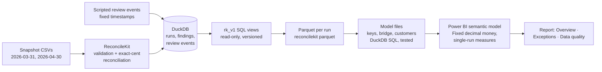

# ReconcileKit: Power BI demonstration

A month-end reconciliation, followed through to a reporting model. Two synthetic snapshots of
an invoice register and a payment ledger are validated and reconciled by ReconcileKit, stored
in DuckDB, published through the read-only `rk_v1` SQL views, exported to Parquet, and modelled
for Power BI with exact money types and a DAX measure catalog.

> **Status: the data pipeline, model files, and checks are complete and tested. The Power BI
> report itself has not been built yet,** because Power BI Desktop was not available in the
> environment where this was developed. Nothing here claims that a dashboard works, and there
> are no screenshots yet. See [Verification status](#verification-status) and
> [Building the report](#building-the-report-in-power-bi-desktop).

## The reporting problem

Finance teams report reconciliation results to people who never see the reconciliation:
controllers want the settled share and the open balance, collections wants the customers and
items to chase, auditors want to know what was excluded and why. Spreadsheet-built reports
recompute those figures independently, mix months together, and drop the rows that failed
validation without saying so.

This demonstration keeps one definition of every number. The engine's totals are the source of
truth; the report reads them rather than re-deriving them, shows data completeness next to every
percentage, never adds two reconciliation runs together, and includes controls that prove the
detail rows add up to the engine totals.

## Architecture



Everything up to and including **G** is built by one script and checked in CI. **H** and **I**
need Power BI Desktop.

## Verification status

| Artifact | Status | How it is verified |
|---|---|---|
| Snapshot data, review events (`dataset/source/`) | ✅ verified | Hand calculation in [`model/model.md`](model/model.md); engine results equal it |
| Per-run `rk_v1` exports (`dataset/rk_v1/`) | ✅ verified | Built by `reconcilekit parquet`; byte-identical on rebuild |
| Model files (`dataset/model/`) | ✅ verified | Schema, keys, exact money, run isolation, control totals: `tests/test_powerbi_demo.py` |
| Expected KPIs (`dataset/expected_kpis.json`) | ✅ verified | SQL over the model files, asserted against hand-calculated constants |
| Power Query script (`model/power-query.m`) | ⚠️ not executed | Generated from the Parquet schemas; a test checks every column and type |
| DAX measures (`model/measures.dax`) | ⚠️ not executed | A test checks every table, column, and measure reference exists; results not yet produced by a DAX engine |
| `.pbip` report and semantic model | ⏳ not built | Requires Power BI Desktop |
| Screenshots | ⏳ none | Will be captured only from the working report |

## Reproduce the data

```bash
python -m pip install -c requirements-lock.txt -e ".[dev]"   # from the repository root
python powerbi/scripts/build_dataset.py           # rebuilds powerbi/dataset/ and model/power-query.m
python powerbi/scripts/build_dataset.py --check   # exit 1 if the committed files differ
pytest tests/test_powerbi_demo.py
```

The build is deterministic (fixed inputs, as-of dates, run creation times, and review timestamps),
and the Parquet files are byte-identical across rebuilds.

## The synthetic data

All data is invented; identifiers, customers, and amounts do not describe any real business.

| Snapshot | As of | Source | Run ID |
|---|---|---|---|
| 2026-03 baseline | 2026-03-31 | ReconcileKit's bundled demo (unchanged) | `RUN-2e17cda32757cc29` |
| 2026-04 follow-up | 2026-04-30 | [`dataset/source/snapshot-2026-04-30/`](dataset/source/snapshot-2026-04-30/) | `RUN-f1b80b3097639ecd` |

Each snapshot is a **complete export** of both registers, not a delta. Between them
([`snapshot_changes.md`](dataset/snapshot_changes.md), generated and tested):

- **Corrected at source:** the duplicate INV-1009 row was removed; INV-1011's missing amount was
  supplied (450.00); PAY-5009's reference was corrected from `inv-1005` to `INV-1005`, as the
  March review recorded.
- **New in April:** invoices INV-1015 and INV-1016; payments PAY-5017 to PAY-5020. PAY-5020
  references `INV-1061`, which does not exist (it looks like a transposition of INV-1016).
- **Now within the as-of date:** INV-1014 and PAY-5015, which were dated after 2026-03-31.
- **Still unresolved:** the INV-1010 and PAY-5014 conflicting duplicates, `99.999`, the EUR
  invoice, `1.2e3`, the blank reference, INV-9999, and the cross-customer payment.
- **Unchanged:** the other 27 identities.

Review activity ([`review_events.json`](dataset/source/review_events.json)): six March events on
five exceptions, ending with two resolved, two acknowledged, and one under investigation; and two
April events, both under investigation. Reviews belong to their run, so the April run starts
with none of the March dispositions.

## Results the report should show

Computed from the model files with the measure definitions, and equal to the hand calculation.
Amounts are USD.

| Snapshot | Run | Eligible invoices | Settled value | Settled % | Outstanding | Payment exceptions (count / amount) | Exceptions | Unresolved | Quarantined rows | Arithmetic |
|---|---|---:|---:|---:|---:|---:|---:|---:|---:|---|
| 2026-03 baseline | `RUN-2e17cda32757cc29` | 7585.75 | 6010.25 | 79.23% | 1575.50 | 6 / 2860.50 | 19 | 17 | 12 | PASS |
| 2026-04 follow-up | `RUN-f1b80b3097639ecd` | 11625.75 | 9785.75 | 84.17% | 1840.00 | 4 / 1325.00 | 14 | 14 | 7 | PASS |

Both runs are *incomplete* (some rows quarantined), and the report says so beside every
percentage. Every item open in March (INV-1003, INV-1005, INV-1007) was settled in April; the
April balance of 1,840.00 is a corrected invoice (INV-1011), one that became eligible
(INV-1014), and two new invoices (INV-1015, INV-1016). The two snapshots are compared side by
side; two points are not presented as a trend.

## Semantic model

Six tables. `Run` carries the engine totals; `Open Invoice`, `Payment Exception`, and
`Exception` are run-scoped detail with composite keys (`run_id|record`), because IDs such as
`EX-0001` repeat in every run. `Customer` and `Bridge Step` are derived. All relationships are
many-to-one, single-direction, from `Run` and `Customer`, with no fact-to-fact relationships.
Money is typed **Fixed decimal**; cents are whole numbers. Details, the relationship diagram,
and the full measure catalog with expected values are in [`model/model.md`](model/model.md).

Double counting is prevented by three rules: run-level KPIs come only from `Run`; they return
BLANK unless exactly one run is selected; and exception amounts are never summed across
categories (they mean different things). Five control measures check that the detail tables tie
to the engine totals.

## Report design (to be built)

Every page has a single-select **snapshot** slicer (default: `Run[is_report_default]`) and a
banner showing *data completeness* and *arithmetic status*.

1. **Reconciliation Overview**: KPI cards (eligible invoices, settled value, settled %,
   outstanding, payment exceptions, unresolved exceptions); bridge waterfall from `Bridge Step`
   (eligible invoices − eligible payments, explained by outstanding, overpayments, unmatched,
   ambiguous, blocked); outstanding by aging bucket; a two-snapshot comparison table (not a
   trend line).
2. **Exception Management**: unapplied payments by status and rule; customer outstanding;
   exceptions by category × current disposition; a payment-exception detail table (reference as
   received, amount, rule, explanation); drill-through to one exception.
3. **Data Quality and Auditability**: quarantined rows and validation exceptions by rule code;
   the three engine invariants and the five model controls as a pass/fail table; the bridge in
   cents and dollars; review state (never reviewed / open / acknowledged / investigating /
   resolved) with first and latest review times; traceability (run ID, input SHA-256s, engine
   and rule version, as-of date).

**Not shown, because `rk_v1` does not provide it:** a review-event timeline (the contract
exposes only the first and latest review per exception) and field-level validation detail (the
field name and raw value are stored but not in `rk_v1`). Validation is shown by rule code and
source rows instead.

## Building the report in Power BI Desktop

Prerequisites: Windows, [Power BI Desktop](https://powerbi.microsoft.com/desktop/) (free).
Clone the repository **outside OneDrive or SharePoint-synced folders** (for example
`C:\dev\ReconcileKit`); Power BI projects cannot be saved directly to OneDrive, and synced folders
can cause failed saves. Keep the path short: Windows limits project file paths to 260 characters.

1. **Data.** The committed files are ready to use. To rebuild them, run
   `python powerbi/scripts/build_dataset.py`.
2. **Parameter.** In Power Query, create a text parameter `DataFolder` with the absolute path of
   `powerbi\dataset\model`. Power Query does not resolve relative paths.
3. **Queries.** Add one blank query per section of [`model/power-query.m`](model/power-query.m),
   named as the section title, and paste the section. Check in the editor that every `*_usd` and
   `settled_invoice_pct` column shows the Fixed decimal (`$`) type.
4. **Model.** Turn off Auto date/time. Create the seven relationships in
   [`model/model.md`](model/model.md), all many-to-one and single-direction. Hide the key columns.
5. **Measures.** Add the `MEASURE` definitions from [`model/measures.dax`](model/measures.dax),
   for example through DAX query view's *update model* action. Set formats: currency with 2
   decimals, percentages with 2 decimals.
6. **Verify.** Run `measures.dax` in DAX query view. Compare the first result with
   `dataset/expected_kpis.json` and the README table above; every control in the second result
   must be TRUE. Record the outcome in this README.
7. **Report.** Build the three pages above. Save as a Power BI project (`.pbip`) into
   `powerbi/` with short names (`RK.Report`, `RK.SemanticModel`). The default `.gitignore`
   written by Power BI Desktop excludes the local data cache (`.pbi/cache.abf`), so no imported
   data is committed through the model.
8. **Screenshots.** Capture each page from the working report into `powerbi/screenshots/`.

## Limitations

- Refresh is a local Power BI Desktop action. There is no Power BI Service publication,
  gateway, scheduled refresh, or public link; refreshing local files from the Service would
  need an on-premises data gateway.
- Two snapshots of a small synthetic ledger: the demonstration is about correctness and
  controls, not scale or performance.
- Inherited from ReconcileKit: USD only, positive amounts, exact references only; quarantined
  rows carry no amount; reviewer labels are self-reported.
- The DuckDB file is not connected directly. Power BI has no native DuckDB connector, and the
  ODBC route needs a custom connector and lowered extension security; the views are exported to
  Parquet instead.
