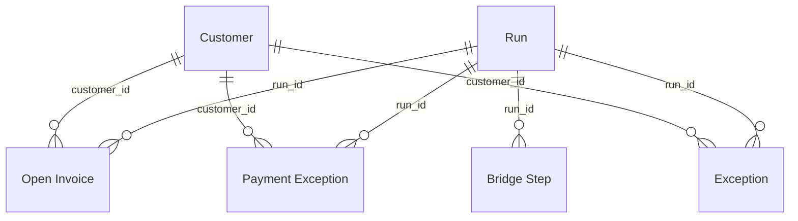

# Semantic model

The model reads the six Parquet files in `powerbi/dataset/model/`. They are produced by
`powerbi/scripts/build_dataset.py` from ReconcileKit's `rk_v1` views and are tested in
`tests/test_powerbi_demo.py`. Keys, list flattening, aging sort order, and the bridge
unpivot are done there in SQL (tested), so that Power Query only loads the files and sets
types (`power-query.m`).

## Runs versus transactions

A **run** is one reconciliation of one complete snapshot of both registers, as of one date.
The same business invoice (for example INV-1001) appears in every snapshot that still
contains it, so it can appear in several runs. Rules that follow from this:

- Every fact row belongs to exactly one run, and every key includes `run_id`.
- Values from different runs are never added together. Run-level KPIs return BLANK unless
  exactly one run is in filter context.
- Reviews belong to a run. The 2026-04-30 run has new exception IDs and starts without the
  March reviews; a reviewer re-recorded one item manually (PAY-5011, "same item as last
  month's review").
- **Report default:** the run with the latest `as_of_date`; ties go to the latest
  `created_at_utc`, then the highest `run_id` (`Run[is_report_default]`). Being newest does not
  make a run authoritative in general; this rule is stated so the choice is explicit.
- No trend is derived from fields that cannot support one: there are two snapshots, and the
  report compares them side by side rather than drawing a time series.

## Tables

| Table | File | Grain | Key | Rows |
|---|---|---|---|---:|
| `Run` | `run.parquet` | one run | `run_id` | 2 |
| `Open Invoice` | `open_invoice.parquet` | one invoice with an outstanding balance, in one run | `run_invoice_key` = `run_id` + `|` + `invoice_record_id` | 7 |
| `Payment Exception` | `payment_exception.parquet` | one eligible payment that was not applied, in one run | `run_payment_key` | 10 |
| `Exception` | `exception.parquet` | one exception in the review queue, in one run | `run_exception_key` | 33 |
| `Customer` | `customer.parquet` | one customer ID that appears in any of the three fact tables | `customer_id` | 8 |
| `Bridge Step` | `bridge_step.parquet` | one line of the reconciliation bridge, in one run | (`run_id`, `step_order`) | 18 |

Columns are the `rk_v1` contract columns (see `docs/sql-reporting.md`) plus:

| Table | Added column | Meaning |
|---|---|---|
| `Run` | `snapshot_label`, `snapshot_order` | Display label and order of the snapshot |
| `Run` | `is_report_default` | TRUE for the run chosen by the default rule above |
| `Open Invoice` | `run_invoice_key`, `run_exception_key`, `aging_order` | Keys; numeric sort order for `aging_bucket` |
| `Payment Exception` | `run_payment_key`, `run_exception_key` | Keys |
| `Exception` | `run_exception_key` | Key |
| `Bridge Step` | `step_code`, `step_label`, `step_kind`, `amount_*`, `signed_*` | `step_kind` is `total`, `subtotal`, or `explains`; `signed_cents` makes the `explains` steps sum to the net difference |

List columns (`record_ids`, `related_invoice_record_ids`) are joined with `;` so that every
column is a scalar.

## Relationships

- All relationships are many-to-one, filtering in a single direction from the one side.
- There are no relationships between fact tables. `run_exception_key` on `Open Invoice` and
  `Payment Exception` is used for drill-through only, so filter paths are never ambiguous.
- `Exception[customer_id]` is blank for some validation rows (for example a duplicate
  payment group). Those rows belong to no customer; customer visuals exclude the blank
  member explicitly.
- No date table. Dates exist (invoice, due, payment, as-of, first/latest review), but at this
  size the aging buckets and the snapshot as-of date carry the analysis. Turn off Auto
  date/time.

## Types

| Parquet | Power BI | Columns |
|---|---|---|
| `BIGINT`, `INTEGER` | Whole number (`Int64.Type`) | all `*_cents`, counts, `source_row`, orders |
| `DECIMAL(38,2)` | **Fixed decimal** (`Currency.Type`) | all `*_usd`, `settled_invoice_pct` |
| `VARCHAR` | Text | identifiers stay text, so `000123` keeps its zeros |
| `BOOLEAN`, `DATE`, `TIMESTAMP` | True/false, Date, Date/time | |

Power BI's *Decimal number* type is a 64-bit floating-point number; *Fixed decimal* is
exact to four decimal places. Every money column is typed explicitly in `power-query.m`;
nothing relies on type detection. Ratios use `DIVIDE`, are formatted as percentages, and
are never stored.

## Measures

Definitions are in [`measures.dax`](measures.dax). Expected values are for the two
snapshots; they come from hand calculation and are reproduced by the SQL in
`build_dataset.py` (`dataset/expected_kpis.json`). **The DAX itself has not been executed
yet** (see the README).

| Measure | Definition | Source columns | Filter context | 2026-03-31 | 2026-04-30 | Blank / zero | Double-count risk |
|---|---|---|---|---:|---:|---|---|
| `Runs In Context` | Distinct runs visible | `Run[run_id]` | any | 1 | 1 | 0 if none | — |
| `Eligible Invoice Value` | I: eligible invoices | `Run[eligible_invoice_usd]` | one run | 7,585.75 | 11,625.75 | BLANK unless one run | guarded |
| `Settled Invoice Value` | I − O (= A − X) | `Run[settled_invoice_usd]` | one run | 6,010.25 | 9,785.75 | as above | guarded |
| `Settled %` | (I − O) / I | `Run[settled_invoice_cents]`, `Run[eligible_invoice_cents]` | one run | 79.23% | 84.17% | BLANK when I = 0 (DIVIDE) | guarded |
| `Outstanding Balance` | O | `Run[outstanding_usd]` | one run | 1,575.50 | 1,840.00 | as above | guarded |
| `Overpayments` | X | `Run[overpayment_usd]` | one run | 50.00 | 110.00 | as above | guarded |
| `Net Difference` | I − P | `Run[net_difference_usd]` | one run | −1,335.00 | 405.00 | as above | guarded |
| `Quarantined Rows` | Invoice + payment rows excluded by validation | `Run[quarantined_*_rows]` | one run | 12 | 7 | as above | guarded |
| `Arithmetic Status` | All three engine invariants | `Run[arithmetic_status]` | one run | PASS | PASS | "Select one run" | — |
| `Data Completeness` | Any rows quarantined? | `Run[data_completeness]` | one run | INCOMPLETE | INCOMPLETE | "Select one run" | — |
| `Payment Exception Count` | Eligible payments not applied | `Payment Exception` rows | one run; status, customer | 6 | 4 | BLANK unless one run; BLANK when none | guarded |
| `Payment Exception Amount` | U + M + B | `Payment Exception[payment_amount_usd]` | as above | 2,860.50 | 1,325.00 | BLANK unless one run; BLANK when none | guarded |
| `Exception Count` | Queued exceptions | `Exception` rows | one run; category, severity | 19 | 14 | BLANK unless one run; BLANK when none | guarded |
| `Unresolved Exceptions` | Latest disposition ≠ RESOLVED_EXTERNALLY | `Exception[is_resolved]` | as above | 17 | 14 | BLANK unless one run; BLANK when none | guarded |
| `Never Reviewed` | No review event | `Exception[review_event_count]` | as above | 14 | 12 | BLANK unless one run; BLANK when none | guarded |
| `Validation Exceptions` | Category VALIDATION | `Exception[category]` | as above; `rule_code` | 9 | 5 | BLANK unless one run; BLANK when none | guarded |
| `Open Invoice Count` | Invoices with outstanding > 0 | `Open Invoice` rows | one run; customer, aging | 3 | 4 | BLANK unless one run; BLANK when none | guarded |
| `Customer Outstanding` | Outstanding per customer | `Open Invoice[outstanding_usd]` | one run; customer | C 975.50 · B 300.00 · D 300.00 | A 800.00 · H 640.00 · F 250.00 · G 150.00 | BLANK unless one run; BLANK for customers with nothing open | guarded |
| `Check Outstanding Ties` | Σ open items = engine O | `Open Invoice[outstanding_cents]`, `Run[outstanding_cents]` | one run | TRUE | TRUE | BLANK unless one run | — |
| `Check Payment Exceptions Tie` | Σ payment exceptions = U + M + B | `Payment Exception[payment_amount_cents]`, `Run[*_payment_cents]` | one run | TRUE | TRUE | as above | — |
| `Check Bridge` | I − P = O − X − U − M − B | `Run[net_difference_cents]`, `Run[explained_difference_cents]` | one run | TRUE | TRUE | as above | — |
| `Check Bridge Steps` | Σ explaining bridge steps = net difference | `Bridge Step[signed_cents]` | one run | TRUE | TRUE | as above | — |
| `Check Settled % Matches SQL` | DAX ratio, rounded, equals the SQL value | `Run[settled_invoice_pct]` | one run | TRUE | TRUE | as above | — |
| `Controls Passed` | How many of the five checks above are TRUE | the check measures | one run | 5 | 5 | BLANK unless one run | — |
| `Controls Status` | "All 5 controls pass", or "n of 5 controls pass" | `Controls Passed` | one run | All 5 controls pass | All 5 controls pass | "Select one snapshot" | — |
| `Selected Snapshot` | Label of the selected snapshot | `Run[snapshot_label]` | one run | 2026-03 baseline | 2026-04 follow-up | "Select one snapshot" | — |
| `Run Banner` | Run ID, as-of date, completeness, quarantined rows, arithmetic status | `Run` | one run | text | text | prompt to select a snapshot | — |
| `Run Provenance` | Storage time, engine version, and rule version of the run | `Run[created_at_utc]`, `Run[engine_version]`, `Run[rule_version]` | one run | Stored 2026-04-01 08:00 UTC · engine 0.1.0 · rules-v1 | Stored 2026-05-01 08:00 UTC · engine 0.1.0 · rules-v1 | "Select one snapshot" | — |
| `Invoice File Hash` | First 16 hex digits of the invoice file SHA-256, for display | `Run[invoice_sha256]` | one run | c9cb41eca9910362… | 654bcc10a4ba49ba… | BLANK unless one run | — |
| `Payment File Hash` | First 16 hex digits of the payment file SHA-256, for display | `Run[payment_sha256]` | one run | b2715151c1218823… | 42857510ec53ce92… | BLANK unless one run | — |
| `Bridge Amount` | Signed bridge line (waterfall value) | `Bridge Step[signed_usd]` | one run; step | O 1,575.50 · X −50.00 · U −1,660.50 · M −1,000.00 · B −200.00 | O 1,840.00 · X −110.00 · U −1,325.00 · M 0.00 · B 0.00 | BLANK unless one run | guarded |

`Never Reviewed`: 19 − 5 reviewed = 14 (March); 14 − 2 = 12 (April).

"Reconciled amount" is shown as **Settled invoice value**, because the phrase could also mean
applied payments (A = 6,060.25 in March), which include the 50.00 overpayment.

## Hand calculation: 2026-04-30 snapshot

Inputs are `dataset/source/snapshot-2026-04-30/`; differences from March are listed in
`dataset/snapshot_changes.md`. As of 2026-04-30:

- **Quarantined invoices (4):** INV-1010 ×2 (conflicting duplicate, unchanged), INV-1012
  (`99.999`, unchanged), INV-1013 (EUR, unchanged). INV-1014 (dated 2026-04-02) is now within
  the as-of date and becomes eligible.
- **Quarantined payments (3):** PAY-5014 ×2 (conflicting duplicate ID), PAY-5016 (`1.2e3`).
  PAY-5015 (dated 2026-04-05) becomes eligible.
- **I** = 1,200.00 + 2,500.00 + 800.00 + 450.00 + 975.50 + 640.25 + 300.00 + 720.00 +
  1,000.00 (INV-1009) + 450.00 (INV-1011) + 150.00 (INV-1014) + 1,800.00 (INV-1015) + 640.00
  (INV-1016) = **11,625.75**
- **Applied, per invoice:** INV-1001 1,200.00 · INV-1002 2,500.00 · INV-1003 500.00 + 300.00
  (PAY-5017) · INV-1004 500.00 + 60.00 (PAY-5015) · INV-1005 975.50 (PAY-5009, reference
  corrected) · 000123 640.25 · INV-1007 300.00 (PAY-5019) · INV-1008 720.00 · INV-1009
  1,000.00 (PAY-5012, no longer ambiguous) · INV-1011 200.00 (PAY-5013, no longer blocked) ·
  INV-1015 1,000.00 (PAY-5018). **A = 9,895.75**
- **O** = 250.00 (INV-1011) + 150.00 (INV-1014) + 800.00 (INV-1015) + 640.00 (INV-1016) =
  **1,840.00**. **X** = 560.00 − 450.00 (INV-1004) = **110.00**. Check: I − A = 1,730.00 =
  O − X.
- **U** = 125.00 (PAY-5008, blank reference) + 310.00 (PAY-5010, INV-9999) + 250.00 (PAY-5011,
  other customer's invoice) + 640.00 (PAY-5020, INV-1061 not found) = **1,325.00**; M = B = 0.
- **P** = A + U = **11,220.75** (18 eligible payments).
- Net difference I − P = **405.00** = O − X − U − M − B = 1,840.00 − 110.00 − 1,325.00.
- Settled = I − O = **9,785.75**; settled share 9,785.75 / 11,625.75 = 84.17%.
- Overdue: INV-1011 (due 2026-03-22, 39 days, `DAYS_31_60`) and INV-1016 (due 2026-04-22, 8
  days, `DAYS_1_30`); INV-1014 and INV-1015 are not yet due.
- Exceptions (14): validation 5 (INV-1010 group, INV-1012, INV-1013, PAY-5014 group,
  PAY-5016), invoice 4 (INV-1004 overpaid, INV-1011 and INV-1015 partially paid, INV-1016
  unpaid and overdue), payment 5 (4 unmatched + PAY-5005's informational
  payment-before-invoice note).
